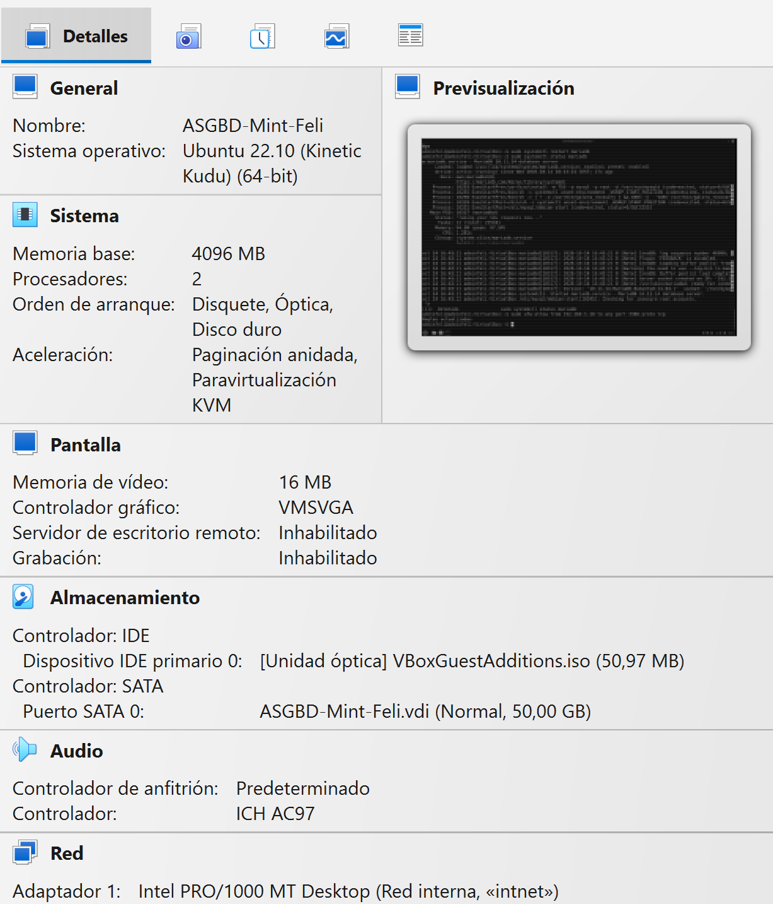

# Práctica: instalar tres SGBD

## 1. Desplegar Oracle Database 23ai Free con Podman

Lo primero que vamos a mostrar para empezar esta tarea son las características de la maquina en la que vamos a instalar tres SGBD, tiene que tener una características mínimas de:

- -4GB de RAM
- -2CPUs
- 25-30GB

Aquí podemos ver las características de mi maquina —>

---

Lo primero que vamos ha hacer en nuestra maquina va a ser actualizar la lista de paquetes e instalar el paquete “podman” —>

`sudo apt update
sudo apt install podman`

Hacemos la comprobación de que se ha descargado correctamente—>

Seguido de la descarga de “podman”, vamos a descargar la imagen oficial de “Oracle Database 23ai”—>

`sudo podman pull [container-registry.oracle.com/database/free:23.5.0.0](http://container-registry.oracle.com/database/free:23.5.0.0)`

Comprobamos que se ha descargado correctamente—>

---

Una vez hemos descargado correctamente “podman” y “Oracle Database 23ai”, creamos el un volumen de almacenamiento, para a continuacion crear el contenedor, con el parámetro “-d” indicamos que se ejecute el contenedor en segundo plano, “--name” para asignar un nombre al contenedor, “-p” indicamos el puerto a través el cual nos vamos a conectar, “-e” para exponer variables de entorno, en este caso para configurar una contraseña (la misma forma que en la tarea pasada), y por último “-v” para guardar los datos en un volumen de podman,  esperamos a que en la columna de “STATUS” este “healthy”—>

Aquí podemos ver un ejemplo de que ya esta “healthy”—>

> *Si no queremos poner la contraseña en terminal ya que no es seguro al no estar esta cifrada, creamos el contenedor de igual forma pero sin el parámetro “-e”, ejecutamos ‘`sudo podman logs cont-oracle`’ donde podremos ver la contraseña que se ha asignado automáticamente.
> 

---

Abrimos una terminal dentro del contenedor para comprobar que podemos conectarnos—>

Accedemos al interprete de comandos de Oracle dentro del contenedor creado anteriormente con el usuario “sysdba”—>
`sudo podman exec -it cont-oracle sqlplus / as sysdba`

Una vez dentro nos movemos a la PDB “FREEPDB1” ,creamos el usuario “orauser”, le damos la contraseña de la practica anterior para las capturas (así no comprometemos contraseñas personales), le damos al usuario permisos para poder iniciar sesión y para poder crear sus propias tablas, y le asignamos una cuota de 100MB y salimos —>

Comprobamos que tenemos acceso con el usuario creado—>

---

---

## 2. Desplegar PostgreSQL

volvemos ha hacer un update (si es necesario) y descargamos “postgresql” que es el motor principal del SGBD, “postgresql-contrib” un paquete de extensiones, herramientas y módulos adicionales, y por ultimo “php-pgsql” que es la extensión para la conexión PHP a PostgreSQL—>

`sudo apt update
sudo apt install postgresql postgresql-contrib php-pgsql`

Arrancamos y configuramos PostgreSQL para que el servicio se inicia automáticamente cada vez que arranquemos el sistema —>

Una vez levantado, pasamos a acceder a postgres, estando dentro creamos una base de datos llamada “dbpg”, creamos un usuario llamado “pguser” y le damos la contraseña que estamos asignando siempre en esta tarea, para antes de salir, darle a este usuario recién creado los todos los permisos sobre la base de datos también creada ahora—>

A continuacion probamos el acceso de forma local con el usuario y la base de datos creada—>

---

---

## 3. Desplegar MariaDB

Volvemos ha hacer un update (si es necesario) y descargamos mariadb-server y mariadb-client—>

`sudo apt update
sudo apt install mariadb-server mariadb-client`

Lo primero que tenemos que hace es levantar el servicio de “mariadb”—>

`sudo systemctl enable —now mariadb`

Accedemos con sudo a “mariadb”, una vez dentro vamos a crear la base de datos dbm (especificando la codificación y definiendo las reglas de comparación y orden de texto), seguido de la creación de un usuario “muser” al cual le asignamos la misma contraseña que al usuario de PostgreSQL, ahora le damos a este usuario todos los permisos sobre la base de datos “dbm”, para recargar las tablas de permisos antes de salir—>

Comprobamos el acceso local con el usuario y base de datos creada—>

---

---

## 4. Resumen y comprobaciones

| SGBD | IP | Base/servicio | Puerto | Usuario | Contraseña |
| --- | --- | --- | --- | --- | --- |
| Oracle 23ai Free | localhost | FREEPDB1 | 1521 | orauser | ClaseOracle_2026 |
| PostgreSQL | localhost | dbpg | 5432 | pguser | ClaseOracle_2026 |
| MariaDB | localhost | dbm | 3306 | muser | ClaseOracle_2026 |

Comprobamos desde la maquina principal el acceso a traves de los respectivos puertos de cada SGBD—>

---

Ahora nos vamos a la maquina cliente para descargar los paquetes necesarios para poder comprobar la conexión—>

`sudo apt update
sudo apt install -y postgresql-client mariadb-client netcat-openbsd`

Comprobamos que se han instalado correctamente—>

Nos vamos al apartado de red tanto de la maquina cliente como de la maquina servidor, y configuramos el adaptador de red en red interna, este modo no incluye DHCP automático, por lo que vamos a tener que configurar nosotros las IPs—>

Ahora pasamos a configurar las IPs en cada maquina, primero limpiamos todas las direcciones de la interfaz de red “enp0s3” (que es el nombre que nos pone VirtualBox a la primera interfaz por defecto)—>

`sudo ip addr flush dev enp0s3`

Le asignamos la IP que deseemos con su respectiva mascara a la interfaz de red principal-->
`sudo ip addr add 192.168.1.10/24 dev enp0s3`

Y por ultimo levantamos la interfaz-->
`sudo ip link set enp0s3 up`

Hacemos un ‘`ip a`’ para comprobar que la IP se ha asignado correctamente—>

Realizamos un ping desde el cliente hacia el servidor para comprobar la conectividad—>

Ahora probamos a conectarnos desde el cliente al servidor a través de cada SGBD, como podemos observar nos va a dar error tanto con MariaDB como con PostgreSQL, eso lo tratamos en el punto 5, pero como vamos a poder ver al hacer un “`nc`” nos dice que es alcanzable el puerto—>

---

---

## 5. Conexiones desde otra máquina

Accedemos al archivo de configuración de PostgreSQL— >

`sudo nano /etc/postgresql/16/main/postgresql.conf`

Para cambiar la “listen_addresses” y poner la IP del servidor para que la maquina cliente pueda comunicarse con la base de datos—>

Accedemos al archivo “pg_hba.conf” que es el archivo que funciona como filtro de seguridad de PostgreSQL—>

`sudo nano /etc/postgresql/16/main/pg_hba.conf`

Y añadimos en la ultima linea la información de acceso para nuestra maquina cliente, con la información del nombre de la base de datos  a la que nos vamos a conectar (dbpg), seguido del nombre de usuario al que le damos permisos (pguser), la IP de nuestra maquina cliente en /32, para que solo se permita el acceso de nuestra maquina (si ponemos la dirección de red en /24, se podrá conectar cualquier otra maquina cliente que este en red interna con la configuración de red adecuada), por ultimo “host” indica que la conexión llegara a través de TCP/IP y “scram-sha-256” es el método de autentificación—>

Una vez todo configurado, reiniciamos PostgreSQL—>
`sudo systemctl restart postgresql`

Comprobamos que UFW esta activo—>
`sudo systemctl status ufw`

Teniendo UFW activo vamos a añadir una nueva regla para que nos deje acceder desde nuestra maquina cliente por el puerto asignado a PostgreSQL—>

`sudo ufw allow from 192.168.1.10 to any port 5432 proto tcp`

Una vez añadida la regla nos vamos a nuestra maquina cliente para probar el acceso —>

---

Accedemos al archivo de configuración de MariaDB—>
`sudo nano /etc/mysql/mariadb.conf.d/50-server.cnf` 

Y cambiamos la “bin-address” por la IP de la maquina servidor para que la maquina cliente pueda comunicarse con la base de datos—>

Ahora accedemos a MariaDB con sudo, volvemos ha hacer los mismo pasos que hicimos el punto 3 para crear el usuario, pero sustituyendo “localhost”, con la IP de nuestra maquina cliente, ya que en MariaDB el usuario esta creado por 2 partes siempre—>

Después de esto reiniciamos MariaDB—>
`sudo systemctl restart mariadb`

Teniendo UFW activo vamos a añadir una nueva regla para que nos deje acceder desde nuestra maquina cliente por el puerto asignado a MariaDB—>

`sudo ufw allow from 192.168.1.10 to any port 3306 proto tcp`

Y por ultimo comprobamos que tenemos acceso desde la maquina cliente—>

### Fuentes consultadas

| TIPO | EJEMPLO DE REFERENCIA |
| --- | --- |
| Chatbot | Gemini |
| web | [https://mariadb.com/docs](https://mariadb.com/docs) |
| web | [https://www.postgresql.org/docs/](https://www.postgresql.org/docs/) |
